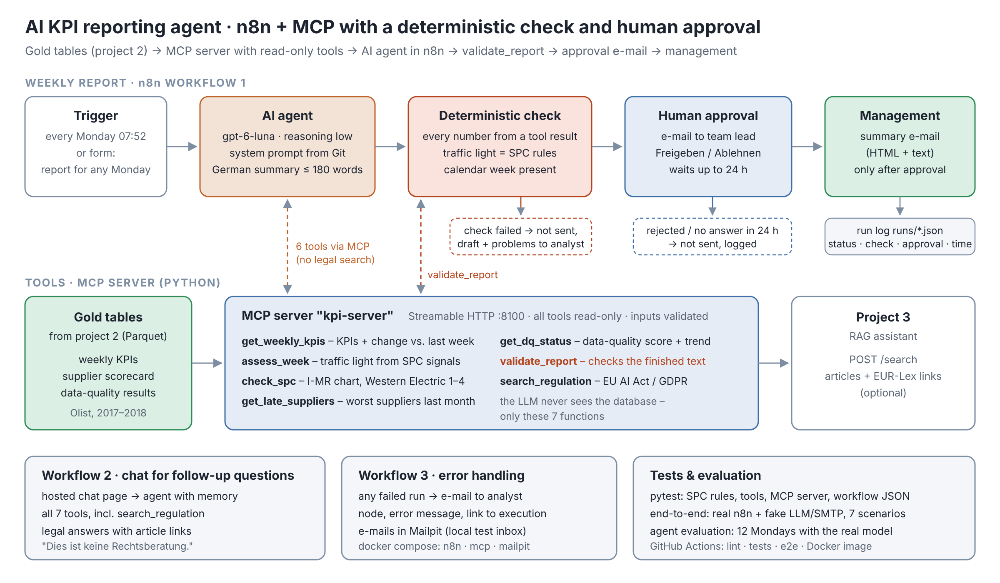
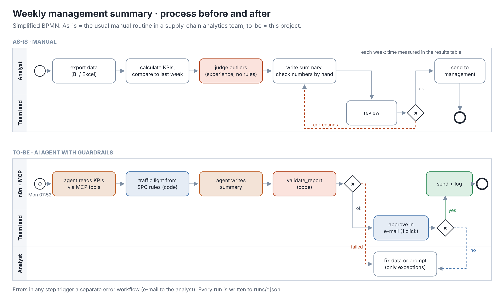

# KI-Agent für KPI-Wochenberichte (n8n · MCP · SPC)

[](https://github.com/Mahsa93-lab/ai-kpi-reporting-agent/actions/workflows/ci.yml)

[English](README.md) · **Deutsch**

> Jeden Montag schreibt ein KI-Agent die Management-Summary zur Liefer- und Lieferantenperformance. Er sieht die Daten nur über sieben lesende Werkzeuge, die Ampel kommt aus Regelkarten-Regeln statt aus der Meinung des Modells, Code prüft jede Zahl im Text, und nichts wird ohne Freigabe-Klick eines Menschen versendet.



## Ausgangslage
Supply-Chain-Teams schreiben jede Woche dieselbe Zusammenfassung fürs Management: Zahlen exportieren, mit der Vorwoche vergleichen, entscheiden, was „auffällig“ ist, ein paar Sätze schreiben, gegenlesen lassen. Das kostet jede Woche Analystenzeit – und ob ein Einbruch ein echtes Problem oder Rauschen ist, entscheidet das Bauchgefühl.

Ein LLM kann den Text schreiben – aber in einer Management-Summary darf keine einzige Zahl falsch sein, und „das Modell fand es auffällig“ ist kein Grund, einen Lieferanten zu eskalieren. Das Projekt zeigt, wie man den Bericht automatisiert, **ohne dem Modell die Fakten anzuvertrauen**: Fakten und Bewertung kommen aus Code, das Modell formuliert nur, ein Mensch gibt frei.

## Wichtigste Ergebnisse
1. **Zahlen prüft der Code, nicht der Leser.** `validate_report` vergleicht jede Zahl des Entwurfs mit den Werkzeugergebnissen der Woche. In der Evaluation über 12 Montage (4 rot, 4 gelb, 4 grün) mit `gpt-6-luna` haben **12 von 12** Berichten bestanden – alle schon mit dem ersten Entwurf –, und eine manuelle Durchsicht aller 12 fand auch im freien Text keine falsche Aussage (z. B. „gestiegene Stornoquote“ = +1,8 Pp ✔). Im End-to-End-Test wird eine erfundene Zahl („71,2 %“) blockiert und geht an die Analyse statt ans Management. Der erste echte Lauf zeigte, wo eine Zahlenprüfung nicht reicht: das Modell gab einer Woche die Regeln einer anderen Kennzahl („Regeln 1, 2, 3“ statt „1, 2“) – kleine Regelnummern bestehen jede Zahlenprüfung. Seitdem schreibt Code die SPC-Zeile, das Modell übernimmt sie wörtlich, und jede Änderung wird abgelehnt.
2. **Die Ampel ist Statistik, keine Modellmeinung.** Rot/Gelb/Grün entscheidet eine I-MR-Regelkarte mit den vier Western-Electric-Regeln auf Lieferanten-Termintreue, Kunden-Termintreue und Reklamationsquote – dieselben Regeln wie in Six Sigma. Über alle 87 Montage: 45 grün, 17 gelb, 25 rot.
3. **Minimale Rechte und Mensch in der Schleife.** Der Berichts-Agent bekommt 6 lesende Werkzeuge (keine Rechtssuche, kein Datenbankzugriff, nichts Schreibendes). Die Management-E-Mail ist nur über *Prüfung bestanden → Freigabe-E-Mail → „Freigeben“* erreichbar – in der CI mit der echten n8n-Engine getestet.
4. **Günstig und schnell:** **0,0013 $ pro Bericht** (≈ 0,07 $ pro Jahr bei wöchentlichen Berichten), Median **13 s** pro Bericht; in n8n 15 s vom Formular bis zur Freigabe-E-Mail. Manuell, einmal gemessen: mindestens 12 min nur für das Zusammentragen und Eintragen der Zahlen, mit fertigem Dashboard – im BMW-Kundenprojekt etwa ein Arbeitstag inklusive Datenbeschaffung.

## Daten
- Gold-Tabellen aus [Projekt 2](https://github.com/Mahsa93-lab/lakehouse-supply-chain-pipeline) (Databricks-Lakehouse auf dem öffentlichen [Olist-Datensatz](https://www.kaggle.com/datasets/olistbr/brazilian-ecommerce), CC BY-NC-SA 4.0), als Parquet in `data/`:
  - `gold_weekly_kpis` – 87 vollständige Wochen (Jan. 2017 – Aug. 2018)
  - `gold_supplier_scorecard` – Monatswerte je Lieferant (IDs auf 8 Zeichen gekürzt)
  - `dq_results` – Ergebnisse der 13 Datenqualitätsprüfungen
- Der Bericht eines Montags betrifft die **vorherige vollständige Woche**; unvollständige Wochen am Datenende werden übersprungen.

## Vorgehen
1. **MCP-Server** (`mcp_server/`, offizielles Python-MCP-SDK, Streamable HTTP): sieben Werkzeuge mit typisierten, geprüften Parametern und Read-only-Kennzeichnung. Alle Zahlen verlassen den Server bereits so gerundet, wie der Bericht sie braucht.
2. **SPC** (`mcp_server/spc_rules.py`): I-MR-Karte über 26 Wochen, Grenzen aus den ersten 20 (σ = mittlere gleitende Spannweite / 1,128), Western-Electric-Regeln 1–4, nur Signale in *ungünstiger* Richtung zählen. Signal in der Berichtswoche = rot, in den 3 Wochen davor = gelb, sonst grün.
3. **Agent** (n8n-AI-Agent, `prompts/management_summary_de.md`): feste Reihenfolge der Werkzeugaufrufe, festes Format (≤ 180 Wörter), Zahlen nur aus Werkzeugen, Empfehlung als Vorschlag – keine automatischen Sanktionen. Modell `gpt-6-luna`, Reasoning low, über die **Responses API** – nur dort akzeptiert OpenAI für dieses Modell Werkzeuge zusammen mit Reasoning (im ersten echten Lauf gefunden; die LLM-Attrappe im E2E-Test prüft seitdem dieselbe Regel).
4. **Deterministische Prüfung** (`validate_report`): ein eigener n8n-Knoten ruft das Werkzeug noch einmal mit dem fertigen Text auf – die Prüfung hängt also nicht davon ab, ob der Agent daran denkt. Geprüft wird: jede Zahl stammt aus einem Werkzeugergebnis, ein Vorzeichen passt zur Richtung in den Daten („+7,3 Pp“ bei einem Rückgang wird abgelehnt), die Zahl direkt nach einer Kennzahl ist der Wert *dieser* Kennzahl, die SPC-Zeile ist wörtlich die aus `assess_week`, Ampel und Kalenderwoche stimmen. Jedes Problem kommt als konkrete Korrektur zurück; der Agent hat zwei Versuche.
5. **Freigabe** (n8n „Send and Wait“): die Teamleitung bekommt den geprüften Entwurf mit *Freigeben / Ablehnen* und hat 24 h Zeit. Nur „Freigeben“ versendet die E-Mail ans Management. Da sich eine versendete E-Mail nicht mehr ändern lässt, bekommt die Teamleitung eine Bestätigung ihrer Entscheidung („✅ Freigegeben … gesendet“ / „❌ Abgelehnt … nicht versendet“); es zählt nur der erste Klick.
6. **Chat für Rückfragen** (Workflow 2): gehostete n8n-Chatseite, Agent mit Gesprächsverlauf und allen 7 Werkzeugen. Rechtsfragen gehen an `search_regulation` – die Such-API aus [Projekt 3](https://github.com/Mahsa93-lab/eu-ai-act-rag-assistant) – mit Artikel und EUR-Lex-Link.
7. **Betrieb**: Fehler-Workflow (E-Mail mit Knoten, Meldung, Link), JSON-Protokoll pro Lauf in `runs/` (Agentenzeit vs. Gesamtzeit), Docker Compose mit n8n 2.42.4, MCP-Server und Mailpit als lokalem Test-Postfach.
8. **Workflows als Code** (`n8n/build_workflows.py`): die Prompts kommen aus `prompts/*.md`, ein Test schlägt fehl, wenn JSON und Generator auseinanderlaufen. Keine Zugangsdaten im Repository.

## Warum das sicher ist
| Risiko | Schutz | Wo |
|---|---|---|
| Modell erfindet oder verschreibt eine Zahl | jede Zahl gegen Werkzeugergebnisse geprüft, inkl. Vorzeichen und Kennzahl; sonst kein Versand, Analyse informiert | `validate_report` + IF-Knoten |
| Modell verwechselt Regelkarten-Signale | SPC-Zeile schreibt der Code (`signals_summary`), wörtlich übernommen und geprüft | `assess_week`, `validate_report` |
| Modell dramatisiert oder verharmlost | Ampel aus SPC-Regeln; Emoji wird geprüft | `assess_week`, `validate_report` |
| Modell liest oder ändert Daten | kein SQL, keine schreibenden Werkzeuge; 6 von 7 Werkzeugen für den Bericht | MCP-Server, `excludeTools` |
| Falscher Bericht erreicht das Management | Freigabe durch Menschen; Ablehnen / keine Antwort → kein Versand | Send and Wait |
| Fehler bleiben unbemerkt | Fehler-Workflow, Protokoll pro Lauf | Workflow 3, `runs/` |
| Schlüssel im Git | nur in `.env`, einmal importiert, in n8n verschlüsselt | `n8n/setup.sh` |
| Rechtsauskunft als Beratung verstanden | nur gefundener Artikeltext + Link, fester Hinweis „keine Rechtsberatung“ | Chat-Prompt |

## Ergebnisse
Evaluation über 12 Montage – vollständige Tabelle und alle Berichte: [docs/agent_eval_results.md](docs/agent_eval_results.md) · [docs/agent_eval_reports.md](docs/agent_eval_reports.md)

| Kennzahl | Ergebnis |
|---|---|
| Berichte, die die Prüfung bestehen | **12 / 12** (100 %) |
| … schon mit dem ersten Entwurf | 12 / 12 |
| Alle Abschnitte · ≤ 180 Wörter | 12 / 12 · 12 / 12 (Median 78 Wörter) |
| Dauer pro Bericht (Median) | 13,4 s (7–17 s) |
| Kosten pro Bericht | 0,0013 $ (≈ 11.000 Eingabe- / 700 Ausgabe-Tokens) |

Über die Tabelle hinaus: das Modell hielt in jedem Lauf die Reihenfolge der Werkzeuge ein und übernahm die SPC-Zeile wörtlich. KW 28/2018 zeigt die Statistik bei der Arbeit: die Kunden-Termintreue fiel um 3,9 Pp, blieb aber innerhalb der Regelgrenzen – grün, keine Eskalation, und das Modell empfahl trotzdem, sie zu beobachten. Grenzen der Evaluation: 12 Wochen, ein Modell, je ein Lauf; die Durchsicht des freien Textes war manuell.

**Abgleich mit dem Power-BI-Dashboard aus Projekt 1** (manuell für KW 9/2018): alle neun Werte – fünf Kennzahlen der Woche, Vorwoche, Datenqualität – sind identisch. Ein Lieferant wich um 0,1 Pp ab (15,0 % vs. 15,1 %): die Gold-Tabelle aus Projekt 2 speichert die Quote auf vier Nachkommastellen (0,1505), und Pythons `round()` machte aus 15,05 eine 15,0. Die Werkzeuge runden jetzt kaufmännisch wie Excel und Power BI (mit Test); Screenshots und Evaluation oben stammen von vor dieser Korrektur.

| Schritt | Manuell (einmal gemessen, KW 9/2018) | Mit Agent |
|---|---|---|
| Zahlen zusammentragen | 2 min 10 s (Power-BI-Seite mit vorbereitetem Wochenfilter) | – |
| Zahlen in die deutsche Vorlage eintragen | ≈ 10 min | – |
| Auffälligkeiten bewerten, Empfehlung schreiben | nicht gemessen (nach Augenmaß am Monatstrend, ohne Regelkarte) | SPC-Regeln im Code, Text vom Agenten |
| **Zeit Analyse** | **≥ 12 min** (nur Zahlen) | **0 min** (nur bei Ausnahmen) |
| Bis der Entwurf fertig ist | ≥ 12 min | 15 s nach dem Start |
| Teamleitung | liest und gibt in beiden Fällen frei | liest + 1 Klick |

Ehrlich gelesen: die 12 Minuten umfassen nur das Zusammentragen und Eintragen der Zahlen – Bewertung und Empfehlung kommen hinzu – und setzen saubere Daten und ein fertiges Dashboard voraus. In meinem Kundenprojekt bei BMW dauerte ein vergleichbarer Wochenbericht **etwa einen Arbeitstag** (Erfahrungswert) – vor allem für das Zusammentragen der Daten aus mehreren Quellsystemen, die Konsolidierung und die Plausibilitätsprüfung. Genau diesen Teil automatisieren Projekt 1 und 2 (Dashboard, Pipeline mit Quality Gate); dieses Projekt übernimmt das restliche Lesen, Bewerten und Schreiben. Schon 12 Minuten pro Woche sind rund 10 Stunden pro Jahr für einen Wochenbericht – der größere Gewinn ist Konsistenz: jede Woche dieselben Regeln, jede Zahl geprüft, ein Protokoll pro Lauf; manuell wurden Auffälligkeiten nach Augenmaß bewertet.



## Starten
Benötigt Docker Desktop und einen OpenAI-API-Schlüssel.
```bash
cp .env.example .env                       # OPENAI_API_KEY und N8N_ENCRYPTION_KEY eintragen
docker compose up -d --build               # n8n, MCP-Server, Mailpit
docker compose exec n8n sh /home/node/setup/setup.sh
docker compose restart n8n
```
1. http://localhost:5678 öffnen und das lokale n8n-Konto anlegen.
2. Bericht für einen Montag: http://localhost:5678/form/5f0c7a52-8a64-4d8e-9a43-1b9d6bcd4e01 (z. B. `2018-03-05`; leer = neueste Woche).
3. Freigabe-E-Mail in Mailpit (http://localhost:8025) öffnen, **Freigeben** klicken – die Management-E-Mail kommt, das Protokoll liegt in `runs/`.
4. Chat: http://localhost:5678/webhook/0b7e5d2c-3f4a-4b8e-9c1d-6a2f8e4b7c90/chat – für Rechtsfragen vorher Projekt 3 starten (Port 8000).

Evaluation: `pip install -r requirements-dev.txt` und `python scripts/evaluate_agent.py`. Erwartete Ergebnisse jedes Schritts: [docs/expected-results.md](docs/expected-results.md)

## Tests
- `pytest` – 46 Tests ohne Netz und Schlüssel: SPC-Grenzen und alle vier Regeln, alle Werkzeuge auf festen Wochen, `validate_report` mit guten und manipulierten Berichten, der MCP-Server im Prozess, die Workflow-Dateien (passen zum Generator, Prompts wörtlich, keine Geheimnisse, Freigabe nicht umgehbar).
- `bash tests/e2e/run_e2e.sh` – startet das **echte n8n 2.42.4** mit den drei Workflows; nur LLM, Mailserver und Projekt 3 sind kleine Attrappen. 7 Szenarien: Freigeben, Ablehnen, erfundene Zahl blockiert, neueste Woche, Chat mit Rechtssuche, Modelleinstellungen, Fehler-E-Mail bei ausgefallenem MCP-Server.
- GitHub Actions: Lint + pytest, End-to-End-Test, Docker-Image des MCP-Servers bauen und per MCP aufrufen.

## Grenzen
- Historische öffentliche Daten (2017–2018): der „Montag“ wird über das Formular simuliert.
- Die Prüfung deckt Zahlen, Vorzeichen, Kennzahl-Wert-Paare, SPC-Zeile, Ampel und Woche ab – nicht den Sinn freier Sätze wie der Empfehlung. Deshalb bleibt die Freigabe.
- Nach der Verschiebung durch Black Friday 2017 signalisiert die Karte monatelang (25 rote Wochen) – statistisch korrekt, in der Praxis würde man die Grenzen nach geklärter Ursache neu berechnen.
- E-Mails gehen nur an Mailpit; im Echtbetrieb wird nur die SMTP-Verbindung getauscht (z. B. Microsoft 365).

## Nächste Schritte
- Grenzen auf Wunsch neu berechnen („Prozess geändert seit …“) und die I-MR-Karte als Bild in die E-Mail.
- Evaluation bei jeder Prompt- oder Modelländerung wiederholen, bevor umgestellt wird.
- Derselbe Ablauf in Power Automate / Copilot Studio.

## Portfolio
Fünf zusammenhängende Projekte zu vertrauenswürdigen Daten und KI in der Supply Chain – vom Dashboard über die Pipeline und den Agenten bis zur Bestandsentscheidung:

| # | Projekt | Fragestellung | Stack |
|---|---|---|---|
| 1 | [Lieferanten- & Lieferperformance](https://github.com/Mahsa93-lab/supplier-delivery-performance-powerbi) | Welche Lieferanten verursachen Verspätungen – und was kosten sie an Reklamationen? | SQL Server · Power BI · DAX |
| 2 | [Lakehouse-Pipeline Supply Chain](https://github.com/Mahsa93-lab/lakehouse-supply-chain-pipeline) | Lassen sich dieselben Kennzahlen täglich, automatisch und hinter einem Datenqualitäts-Gate erzeugen? | Databricks · PySpark · Delta Lake |
| 3 | [Assistent EU AI Act & DSGVO](https://github.com/Mahsa93-lab/eu-ai-act-rag-assistant) | Kann ein KI-Assistent Rechtsfragen mit überprüfbaren Quellen beantworten? | RAG · OpenAI · FastAPI · Docker |
| 4 | **KI-Agent für KPI-Wochenberichte** *(dieses Repository)* | Kann ein KI-Agent die wöchentliche Management-Summary schreiben – ohne eine einzige ungeprüfte Zahl? | n8n · MCP · SPC · Docker |
| 5 | [Bestandsoptimierung: Servicegrad vs. Kapital](https://github.com/Mahsa93-lab/bestandsoptimierung-servicegrad) | Was kostet jedes Prozent Lieferfähigkeit an Bestand – und wo verhindert dasselbe Kapital die meisten Defekte? | Python · pandas · SciPy · Simulation |

Die Projekte bauen aufeinander auf: Projekt 2 liefert dieselben Zahlen wie Projekt 1 auf den Cent genau (99.441 Bestellungen, 13.591.643,70 BRL Umsatz); der Agent in Projekt 4 liest die Gold-Tabellen aus Projekt 2 und nutzt die Such-API aus Projekt 3; Projekt 5 macht aus den Kennzahlen eine Bestandsentscheidung – wie viel Bestand, wo und mit welchem Servicegrad (synthetische Daten).

---
*Autorin: Mahsa Ahmadi · Daten: öffentlicher Olist-Datensatz (CC BY-NC-SA 4.0).*
