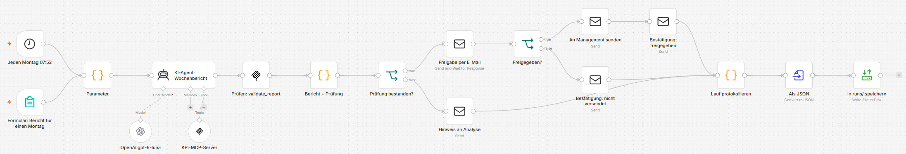
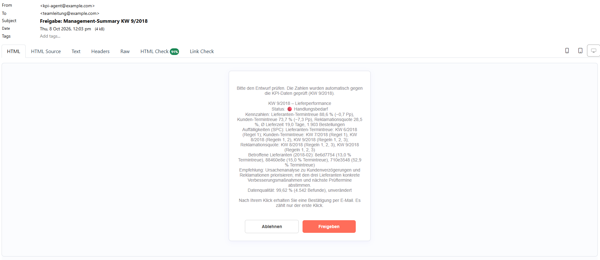
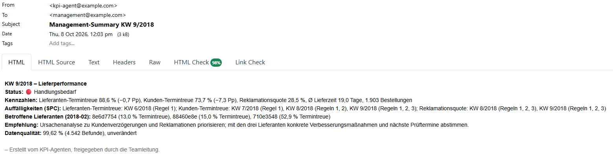
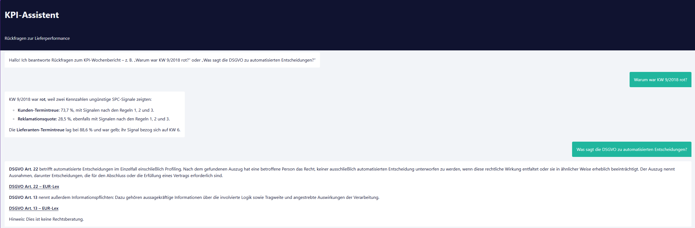

# AI KPI Reporting Agent (n8n · MCP · SPC)

**English** · [Deutsch](README.de.md)

> Every Monday an AI agent writes the German management summary on supplier and delivery performance. It sees the data only through seven read-only tools, the traffic light comes from control-chart rules instead of the model's opinion, code checks every number in the text, and nothing is sent without a human approval click.


## Business problem
Supply-chain teams write the same weekly summary for management again and again: export the numbers, compare them with last week, decide what is "unusual", write a few sentences, get them checked. It costs analyst time every week, and whether a dip is a real problem or noise is decided by gut feeling.

An LLM can write the text – but management summaries must not contain a single wrong number, and "the model thought it looked bad" is not a reason to escalate to a supplier. This project shows how to automate the report **without trusting the model with facts**: the facts and the judgement come from code, the model only writes, and a person approves.

## Key results
1. **Numbers checked by code, not by the reader.** `validate_report` compares every number in the draft with the tool results of that week. In the evaluation on 12 Mondays (4 red, 4 yellow, 4 green) with `gpt-6-luna`, **12 of 12** reports passed – all of them with the first draft – and a manual review of all 12 found no wrong statement in the free text either (e.g. "gestiegene Stornoquote" = +1,8 Pp ✔). In the end-to-end test an invented number ("71,2 %") is blocked and goes to the analyst instead of management. The first real run showed where a number check is not enough: the model gave a week the control-chart rules of another KPI ("Regeln 1, 2, 3" instead of "1, 2") – small rule numbers pass any number check. Since then the SPC line is written by code and copied verbatim, and the check rejects any change to it.
2. **The traffic light is statistics, not model opinion.** Red/yellow/green is decided by an I-MR control chart with the four Western Electric rules on supplier on-time delivery, customer on-time delivery and complaint rate – the same rules used in Six Sigma. Over all 87 Mondays: 45 green, 17 yellow, 25 red.
3. **Least privilege and human in the loop.** The report agent gets 6 read-only tools (no legal search, no database access, nothing that writes). The management e-mail is reachable only via *check passed → approval e-mail → "Freigeben"* – tested in CI with the real n8n engine.
4. **Cheap and fast:** **$0.0013 per report** (≈ $0.07 per year of weekly reports), median **13 s** per report; in n8n 15 s from the form to the approval e-mail. Manual baseline: ⟨…⟩ min per report.

## Data
- Gold tables from [project 2](https://github.com/Mahsa93-lab/lakehouse-supply-chain-pipeline) (Databricks lakehouse on the public [Olist e-commerce dataset](https://www.kaggle.com/datasets/olistbr/brazilian-ecommerce), CC BY-NC-SA 4.0), exported as Parquet to `data/`:
  - `gold_weekly_kpis` – 87 complete weeks (Jan 2017 – Aug 2018): orders, supplier and customer on-time delivery, complaint rate, lead time, revenue
  - `gold_supplier_scorecard` – monthly values per supplier (IDs shortened to 8 characters)
  - `dq_results` – results of the 13 data-quality checks of the pipeline
- The report for a Monday covers the **previous complete week**; incomplete weeks at the end of the data are skipped automatically.

## Approach
1. **MCP server** (`mcp_server/`, official Python MCP SDK, Streamable HTTP): seven tools with typed, validated parameters and read-only annotations – `get_weekly_kpis`, `assess_week`, `check_spc`, `get_late_suppliers`, `get_dq_status`, `validate_report`, `search_regulation`. All numbers leave the server already rounded and formatted the way the report needs them.
2. **SPC** (`mcp_server/spc_rules.py`): I-MR chart over 26 weeks, control limits from the first 20 (σ = mean moving range / 1.128), Western Electric rules 1–4, only signals in the *unfavourable* direction count. Rule → traffic light: signal in the report week = red, in the 3 weeks before = yellow, otherwise green.
3. **Agent** (n8n AI Agent node, `prompts/management_summary_de.md`): fixed order of tool calls, fixed format (≤ 180 words), numbers only from tools, recommendation as a proposal for people – no automatic supplier sanctions. Model `gpt-6-luna` with reasoning effort low via the OpenAI **Responses API** – for this model OpenAI accepts tools together with a reasoning effort only there, not in chat completions (found in the first real run; the fake LLM of the e2e test now enforces the same rule).
4. **Deterministic check** (`validate_report`): a separate n8n node calls the tool again on the final text – so the check does not depend on the agent remembering to do it. Every number must appear in a tool result of that week (German and English number formats, dates removed), a sign in front of a number must match the direction in the data ("+7,3 Pp" for a drop is rejected), the number right after a KPI name must be the value of *that* KPI, the SPC line must be exactly the one from `assess_week`, the emoji must match, the calendar week must be present. Each problem comes back as a concrete correction, and the agent gets two attempts to fix it.
5. **Approval** (n8n "send and wait" e-mail): team lead gets the checked draft with *Freigeben / Ablehnen*; waits up to 24 h. Only "Freigeben" sends the HTML + text e-mail to management. An e-mail cannot change after it is sent, so the team lead gets a confirmation e-mail of the decision ("✅ Freigegeben … gesendet" / "❌ Abgelehnt … nicht versendet"); only the first click counts, a second one shows "No action required".
6. **Chat for follow-up questions** (workflow 2): hosted n8n chat page, agent with memory and all 7 tools. Legal questions ("What does the GDPR say about automated decisions?") go to `search_regulation`, which calls the search API of [project 3](https://github.com/Mahsa93-lab/eu-ai-act-rag-assistant) and returns articles with EUR-Lex links.
7. **Operations**: error workflow (any failure → e-mail with node, message and link), one JSON log per run in `runs/` (status, check result, approval, agent time vs. total time), Docker Compose with n8n 2.42.4, the MCP server and Mailpit as local test inbox.
8. **Workflows as code** (`n8n/build_workflows.py`): the three workflow files are generated, the prompts are inserted from `prompts/*.md`, and a test fails if JSON and generator drift apart. No credentials in the repository – `n8n/setup.sh` imports them from `.env`.

## Why it is safe
| Risk | Guardrail | Where |
|---|---|---|
| Model invents or miscopies a number | every number checked against tool results, signs and KPI names included; failed → not sent, analyst informed | `validate_report` + n8n IF node |
| Model mixes up control-chart signals | SPC line written by code (`signals_summary`), copied verbatim, checked word for word | `assess_week`, `validate_report` |
| Model over- or under-dramatises | traffic light decided by SPC rules; emoji checked | `assess_week`, `validate_report` |
| Model accesses or changes data | no SQL, no write tools; 6 of 7 read-only tools for the report agent | MCP server, `excludeTools` |
| Wrong report reaches management | human approval; reject / timeout → nothing sent | n8n send-and-wait |
| Silent failures | error workflow e-mail, run log per execution | workflow 3, `runs/` |
| Secrets in Git | key only in `.env`, imported once, stored encrypted by n8n | `n8n/setup.sh` |
| Legal answers taken as advice | only retrieved article text + link, fixed "keine Rechtsberatung" | chat prompt |

## Results
Agent evaluation on 12 Mondays (`python scripts/evaluate_agent.py`, model `gpt-6-luna`, reasoning low) – full table and all 12 reports: [docs/agent_eval_results.md](docs/agent_eval_results.md) · [docs/agent_eval_reports.md](docs/agent_eval_reports.md)

| Metric | Result |
|---|---|
| Reports passing the deterministic check | **12 / 12** (100 %) |
| … with the first draft | 12 / 12 |
| All required sections · ≤ 180 words | 12 / 12 · 12 / 12 (median 78 words) |
| Duration per report (median) | 13.4 s (7–17 s) |
| Cost per report | $0.0013 (≈ 11,000 input / 700 output tokens) |

What the 12 weeks show beyond the table: the model followed the tool order in every run (5 tool calls, 4 for green weeks without the supplier lookup) and copied the SPC line verbatim. KW 28/2018 is a good example of the statistics at work: customer on-time delivery fell by 3.9 pp, but stayed inside the control limits – green, no escalation, and the model still recommended watching it. Limits of this evaluation: 12 weeks, one model, one run each; the free-text review was done by hand.

**Cross-check against the Power BI dashboard of project 1** (done by hand for KW 9/2018): all nine values – five KPIs of the week, the previous week, data quality – are identical. One supplier differed by 0.1 pp (15,0 % vs. 15,1 %): the gold table of project 2 stores the rate rounded to four decimals (0.1505), and Python's `round()` turned 15.05 into 15.0. The tools now round half up like Excel and Power BI (with a test); screenshots and the evaluation above were made before this fix.

Time per weekly report:

| | Manual (measured once) | With the agent |
|---|---|---|
| Analyst | ⟨…⟩ min | 0 min (only on exceptions) |
| Team lead | ⟨…⟩ min review | ≈ 1 min reading + 1 click |
| Until the summary is ready | ⟨…⟩ | 15 s after the trigger (+ time until the team lead clicks) |


## Screenshots
| n8n workflow | Approval e-mail (Mailpit) |
|---|---|
|  |  |

| Management e-mail | Chat with legal lookup |
|---|---|
|  |  |

## How to run
Needs Docker Desktop and an OpenAI API key.
```bash
cp .env.example .env                       # add OPENAI_API_KEY and N8N_ENCRYPTION_KEY
docker compose up -d --build               # n8n, MCP server, Mailpit
docker compose exec n8n sh /home/node/setup/setup.sh
docker compose restart n8n
```
1. Open http://localhost:5678 and create the local n8n owner account (stays on your PC).
2. Report for any Monday: http://localhost:5678/form/5f0c7a52-8a64-4d8e-9a43-1b9d6bcd4e01 (e.g. `2018-03-05`; empty = latest week).
3. Open the approval e-mail in Mailpit (http://localhost:8025), click **Freigeben** – the management e-mail arrives, the run log is in `runs/`.
4. Chat: http://localhost:5678/webhook/0b7e5d2c-3f4a-4b8e-9c1d-6a2f8e4b7c90/chat – for legal questions start project 3 first (`docker compose up` there, port 8000).

Agent evaluation (MCP server from Docker running, key in `.env`):
```bash
pip install -r requirements-dev.txt
python scripts/evaluate_agent.py           # 12 Mondays → docs/agent_eval_results.md
```
Expected output of every step: [docs/expected-results.md](docs/expected-results.md)

## Tests
- `pytest` – 46 tests without network or API key: SPC limits and all four rules, every tool on fixed weeks (e.g. KW 9/2018: customer OTD 73.7 %, −7.3 pp, red), `validate_report` with good and manipulated reports, the MCP server in-process (tool list, read-only hints, error messages), and the workflow files (match the generator, prompts verbatim, no secrets, approval cannot be bypassed).
- `bash tests/e2e/run_e2e.sh` – starts the **real n8n 2.42.4** with the three workflows; only the LLM, the mail server and project 3 are replaced by small fakes (`tests/e2e/fakes.py`). 7 scenarios: approve, reject, invented number blocked, latest week by default, chat with legal lookup, model settings (Responses API, reasoning effort, no temperature, 6 tools for the report agent), error e-mail when the MCP server is down.
- GitHub Actions runs lint + pytest, the end-to-end test, and builds the MCP Docker image and calls it over MCP.

## Limitations
- Historic public data (2017–2018): the "Monday" is simulated with the form; the schedule always reports the latest week in the data.
- The check covers numbers, signs, KPI-value pairs, the SPC line, traffic light and week – not the meaning of free sentences such as the recommendation. That is why the human approval stays.
- Control limits come from the 20 weeks before the checked window. After the Black Friday 2017 shift the chart signals for months (25 red weeks) – correct statistically, but in practice the limits would be recalculated once the cause is known.
- Supplier IDs are anonymised hashes; "late handovers" are measured against Olist's shipping limit date.
- E-mails go to Mailpit only; for real use the SMTP credential is replaced (e.g. Microsoft 365) – no code change.

## What I would do next
- Recalculate control limits on demand ("process changed since …") and show the I-MR chart as an image in the e-mail.
- Track the agent evaluation over time (prompt or model change → rerun the 12 weeks before switching).
- Same flow in Power Automate / Copilot Studio for Microsoft-only companies.

## Project structure
```
mcp_server/   data · spc_rules · tools · server (MCP, Streamable HTTP :8100)
prompts/      management_summary_de.md · chat_assistant_de.md
n8n/          build_workflows.py · workflows/*.json (generated) · credentials.template.json · setup.sh
scripts/      evaluate_agent.py (12 Mondays with the real model)
tests/        pytest suite · e2e/ (real n8n + fakes)
data/         gold tables from project 2 (Parquet)
docs/         architecture, process, expected results, evaluation
runs/         one JSON log per report run (not committed)
```

## Portfolio
Four connected projects on trustworthy data and AI in supply chain – from the dashboard to the pipeline to the agent:

| # | Project | Question | Stack |
|---|---|---|---|
| 1 | [Supplier & Delivery Performance](https://github.com/Mahsa93-lab/supplier-delivery-performance-powerbi) | Which suppliers cause late deliveries – and what do they cost in complaints? | SQL Server · Power BI · DAX |
| 2 | [Lakehouse Supply-Chain Pipeline](https://github.com/Mahsa93-lab/lakehouse-supply-chain-pipeline) | Can the same KPIs be produced daily, automatically and behind a data-quality gate? | Databricks · PySpark · Delta Lake |
| 3 | [EU AI Act & GDPR Assistant](https://github.com/Mahsa93-lab/eu-ai-act-rag-assistant) | Can an AI assistant answer legal questions with sources you can check? | RAG · OpenAI · FastAPI · Docker |
| 4 | **AI KPI Reporting Agent** *(this repository)* | Can an AI agent write the weekly management summary without a single unchecked number? | n8n · MCP · SPC · Docker |

The projects build on each other: project 2 reproduces the numbers of project 1 to the cent (99,441 orders, BRL 13,591,643.70 revenue); the agent in project 4 reads the gold tables of project 2 and uses the search API of project 3.

---
*Author: Mahsa Ahmadi · Data: Olist public dataset (CC BY-NC-SA 4.0).*
